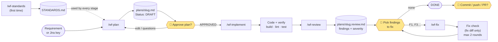
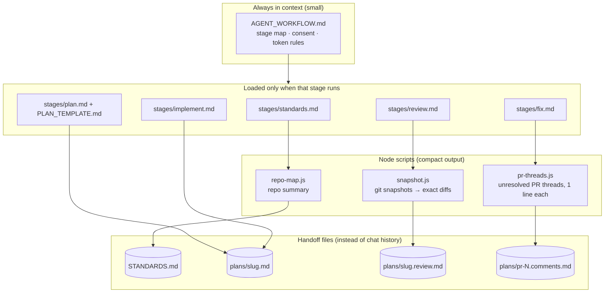
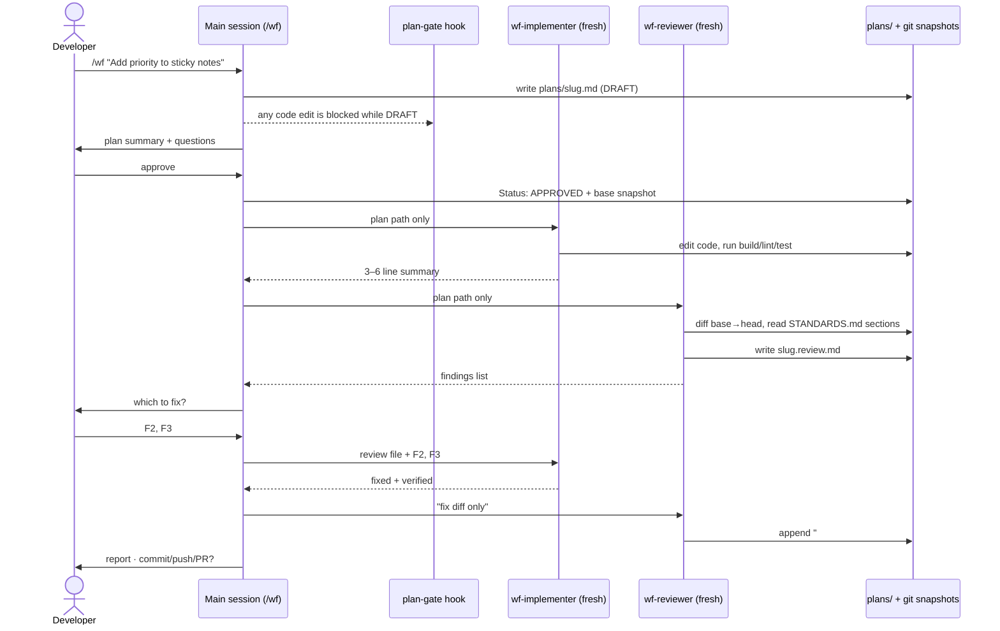
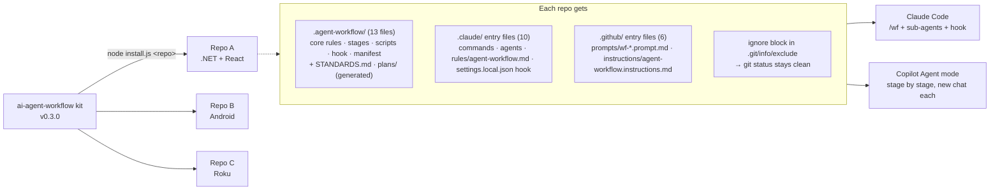

# Demo Guide — AI Agent Workflow Kit (v0.3.0, pilot)

Presenter notes for a 30–40 minute demo. Not installed into repos (`install.js` copies only its own file list).

**One-line pitch:** a drop-in workflow for Claude Code and GitHub Copilot. The agent learns your repo's standards, plans before it codes, waits for your approval, reviews its own work against the requirements and the standards, and fixes only what you pick. It does this in fresh, small contexts, so it uses fewer tokens.

---

## 1. Agenda

| # | Section | Time | What to show |
|---|---|---|---|
| 1 | The problem | 3 min | Slide / talk |
| 2 | How it works (architecture) | 7 min | Diagrams in section 3 below |
| 3 | Live demo: `/wf` on ChaiSE | 15 min | Claude Code in VS Code |
| 4 | Zero footprint: one folder, clean `git status` | 3 min | Terminal in ChaiSE |
| 5 | Advantages | 3 min | Section 5 |
| 6 | Status, limitations, next steps | 4 min | Section 6 |
| 7 | Q&A | 5 min | Section 7 |

### The problem (talking points)
- Agents start coding before they understand the requirement, and the developer only notices in review.
- Long chat sessions burn tokens: every turn re-sends the history, and `/compact` loses details.
- AI-written code ignores the team's conventions, because nobody wrote them down.
- PR review comments get fixed by hand, one by one.
- Teams use different tools (Claude Code, Copilot), and each needs its own setup.

---

## 2. Prep checklist (day before)

- [ ] Prerequisites on the demo machine: git, Node.js, `gh auth login` (for the PR part).
- [ ] ChaiSE is on a clean branch: `git checkout -b demo/<feature>`, and `git status` is clean.
- [ ] **Reinstall the kit in ChaiSE:** `node install.js "<path>\ChaiSE"`. It was removed, together with its `STANDARDS.md` and `plans/`, which were never committed and can't be recovered. Check `git status` is still clean afterwards.
- [ ] **Regenerate standards:** run `/wf-standards` in ChaiSE and approve it. It takes a few minutes, so don't do it live.
- [ ] **First real 0.3.0 check:** in a new Claude Code session in ChaiSE, ask "what are the consent rules?". It should answer from the core rules (which shows `.claude/rules/` is loaded), and `/wf` should appear in the command list. Do the same in Copilot Chat with `/wf-plan`.
- [ ] No leftover `Status: DRAFT` plan in `ChaiSE/.agent-workflow/plans/`; it would block edits (that's the gate, but don't trip it by accident).
- [ ] **Check the lint command.** ChaiSE's `CLAUDE.md` lists `npm --prefix React run lint`. React has since moved to Vite with `eslint.config.js`; make sure `React/package.json` has a `lint` script, or Verify will report it live.
- [ ] `dotnet build API` and `npm --prefix React run build` pass.
- [ ] Pick the demo requirement and do one dry run (see section 4). Note the `/cost` numbers to quote.
- [ ] Open these tabs in advance: `README.md`, `.agent-workflow/AGENT_WORKFLOW.md`, `ChaiSE/.agent-workflow/STANDARDS.md`, `examples/plans/cancel-order.md`, `examples/plans/cancel-order.review.md`.
- [ ] Backup plan: if the live run is slow or fails, walk through the `examples/` files and tell the story of the earlier ChaiSE run (section 4, "Backup").

---

## 3. Architecture diagrams

These are Mermaid diagrams. They render in GitHub and in VS Code's Markdown preview (built in, or with the *Markdown Preview Mermaid Support* extension). For slides, paste them into https://mermaid.live and export as PNG/SVG.

### 3.1 The flow and its consent gates



**Say:** "There are three yellow gates where the human decides. The agent can't edit code while the plan is DRAFT, because a hook blocks it."

### 3.2 What gets loaded, and when (why it's cheap)

Everything below lives in `.agent-workflow/` in the target repo.



### 3.3 `/wf` in Claude Code: main session and sub-agents



**Say:** "The main chat never reads the code after planning. Each sub-agent starts with an empty context and gets a file path, not a chat history."

### 3.4 Installation: one kit, many repos, two tools, nothing committed



**Say:** "Everything goes in one folder, plus the few entry files the tools insist on. All of it is git-ignored locally, so nothing is committed and no team file is edited. Re-running `install.js` upgrades a repo and skips files you've edited."

---

## 4. Live demo script (ChaiSE)

**Setup on screen:** VS Code with ChaiSE open, Claude Code panel, terminal visible.

### Step 0 — Install (1 min, live on a throwaway clone)
ChaiSE itself was installed during prep. To show the install, clone it and install into the clone; it takes a second and lists the 29 files it added and the ignore block it wrote.
```
git clone "C:\...\ChaiSE" %TEMP%\chaise-demo
node install.js %TEMP%\chaise-demo
git -C %TEMP%\chaise-demo status        ← nothing new: the kit is invisible to git
```
Then, in ChaiSE, open the `.agent-workflow/` folder in the explorer to show where everything lives.
**Say:** "No `CLAUDE.md` edits, no `.gitignore` edits, nothing to commit. Teammates who don't use it never see it."

### Step 1 — Standards (2 min, show the file generated during prep)
Open `ChaiSE/.agent-workflow/STANDARDS.md`. Point out:
- It was generated from the code, and each rule cites an example file.
- The "Decisions needed" items were settled by a human (e.g. the secrets rule is marked "decided").
- Areas: `API/` (.NET minimal API) and `React/`.
- Mention `/wf-standards --refresh`: it re-samples only the areas that changed.

### Step 2 — `/wf` with a small requirement (10 min, live)
Pick something small that touches both API and UI, so the review has something to say. Suggestions:
- `/wf Add an optional due date to sticky notes, set on create/edit and shown on the card`
- `/wf Show the count of open (not done) sticky notes in the sidebar header`

Narrate while it runs:
1. **Plan:** it searches, then writes `.agent-workflow/plans/<slug>.md`. Open it: goal, approach and the alternative considered, testable acceptance criteria, files to touch with `file:line` facts.
2. **Gate demo (30 sec):** before approving, ask it to "just start editing the API". The hook blocks the edit. *This is the strongest moment of the demo.*
3. **Approve.** The implementer sub-agent runs, then reports in 3–6 lines with build/lint results.
4. **Review:** the reviewer sub-agent writes `.agent-workflow/plans/<slug>.review.md`. Show the severity, the `file:line` locations, the rule cited from STANDARDS.md, and the AC-by-AC requirement check.
5. **Pick findings:** answer "F2" (or similar). Show `## Round N` appended: only the fix diff is reviewed.
6. **Finish:** the agent asks before committing. Say no (or yes, on the demo branch).
7. Run `/cost` and quote the number.

### Step 3 — PR comments (2 min, optional, needs a real PR)
`/wf-fix <PR#>` → it reads only the unresolved threads (`pr-threads.js`), proposes fix/reply/clarify for each, and waits for consent before changing code or replying. Show `examples/plans/pr-42.comments.md` if there's no PR handy.

### Backup — walk through a completed real run
The plan and review files from the earlier ChaiSE run were deleted along with the kit (the code it produced is in ChaiSE commit `6e75431`). If the live run is slow, open `examples/plans/cancel-order.md` and `cancel-order.review.md` to show the shape, and tell the story of the real run:
- The plan recorded user constraints ("migration must be additive only, don't apply it") and the expected SQL.
- The review:
  - Verdict approve, with 3 findings.
  - **F1** caught a *pre-existing* problem (no lint script) and kept it out of this change's verdict.
  - **F2** caught a real data-loss bug: a PUT without `priority` silently reset High to Medium.
  - F2 and F3 were picked and fixed, and Round 1 confirmed the fixes with no new findings.
  - It states honestly what it did *not* verify ("met by code reading (not run)", "I can't see the user's database").

---

## 5. Advantages

| Benefit | How the kit achieves it |
|---|---|
| **Fewer tokens** | Small always-on core; stage files load on demand; each stage starts fresh from a handoff file; diffs are read with `--stat` first, then one file at a time; lint does the style checking; PR comments come one line each |
| **No surprise code** | Plan approval before any edit, enforced by the `plan-gate` hook in Claude Code |
| **Requirement-driven reviews** | Every acceptance criterion is checked as met, partial or missing, and scope creep is flagged |
| **Your conventions, not generic ones** | `STANDARDS.md` is inferred from your code with evidence, and you approve it; findings cite the rule they break |
| **Reviews that get fixed** | Findings are saved to a file, you pick IDs, and the fix check reviews only the fix diff (at most 2 rounds) |
| **Exact diffs** | `snapshot.js` captures the working tree, including new untracked files, without touching your staging area |
| **PRs without checkout** | `git fetch pull/<n>/head` + `git show`; works with forks and GitHub Enterprise |
| **Safe by default** | Ticket, PR and code text is treated as data, not instructions. No commit, push, PR or comment without a yes |
| **Two tools, one workflow** | The same command names and stage files for Claude Code and Copilot |
| **Any stack** | Areas are detected per repo (.NET, React, Android, Roku, monorepos) |
| **Zero footprint in git** | One `.agent-workflow/` folder plus a few entry files, all ignored via `.git/info/exclude`. Nothing to commit, no team file edited, no confusion in the folder structure |
| **Easy rollout and upgrades** | One installer; fingerprints protect local edits; upgrades from 0.2.0 clean up the old layout |
| **Handoff files on disk** | Plans and reviews in `.agent-workflow/plans/` record why each change was made; copy one out to keep it |

---

## 6. Status (WIP)

**Version 0.3.0 — pilot** (2026-10-22).

### Done
- All five stages: Standards, Plan, Implement, Review, Fix. `/wf` runs them end to end in Claude Code.
- Copilot prompt files for every stage except `/wf`.
- Approval hook, sub-agents, snapshot-based diffs, PR thread tooling (`--fetch`, `--reply`, `--resolve`).
- Installer with safe upgrades (manifest + fingerprints, CRLF-tolerant).
- 0.3.0: everything in `.agent-workflow/`, git-ignored locally, no committed file edited; upgrades from 0.2.0 migrate automatically.
- 0.2.0 fixed the issues a fresh-eyes review found in 0.1.0: hook bypass via markdown formatting, upgrade safety, the fix flow, fork PRs, monorepo detection.

### Piloted so far
- **ChaiSE** (.NET 10 API + React), on 0.2.0: STANDARDS.md generated and approved; `sticky-note-priority` run end to end (plan → implement → review → fix round 1 → DONE); `startup-migrations` implemented.
- **0.3.0** was tested on scratch repos: fresh install, upgrade from a committed 0.2.0 install, Claude-only and Copilot-only installs, re-runs, the hook, `repo-map.js` and `snapshot.js`. It hasn't been run on a real project yet; ChaiSE is next.
- *(Add any other pilots before the demo.)*

### Not yet validated / limitations
- **Token savings aren't measured yet.** No baseline comparison exists. Plan: the same 3–5 tasks with and without the kit, compared with `/cost`.
- **The Copilot path** has less enforcement: no hook and no sub-agents, so the gate relies on the instructions alone. It needs its own pilot.
- **The hook is a guard rail, not a lock.** It covers Edit/Write only, so shell-based writes aren't blocked, and the agent could edit the plan status itself.
- **PR features are GitHub only.** Azure DevOps and GitLab aren't supported yet. Mention this upfront if the audience uses Azure DevOps.
- `pr-threads.js` reads at most 100 threads per PR.
- Snapshots include untracked, non-ignored files, so `.gitignore` must be kept up to date.
- Cheaper sub-agent models (`model: sonnet`) haven't been evaluated for review quality.
- `STANDARDS.md` is per developer by default (ignored). A team that wants one shared copy un-ignores that one file.
- Loading the core rules from `.claude/rules/` (Claude Code) and `.github/instructions/` (Copilot) is documented behaviour, but hasn't been checked in a live session on 0.3.0 yet.

### Next steps (proposed)
1. Pilot on 2–3 more repos with different stacks (Android, Roku, a monorepo).
2. Measure tokens and quality: tokens per task, whether the agent stops at each gate, findings with real `file:line`, fixes passing within 2 rounds.
3. Azure DevOps PR support (equivalent of `pr-threads.js`).
4. A Copilot-specific pilot and tuning.
5. Decide per team whether to share `STANDARDS.md` (un-ignore one file).

---

## 7. Likely questions

- **"Isn't planning slower for small tasks?"** Trivial tasks (typo, rename, one-line fix, questions) skip the stages. The workflow is for non-trivial changes, where a wrong start costs more.
- **"What if STANDARDS.md is wrong?"** You approve it, inconsistencies are put to you as decisions instead of being guessed, and new conventions settled during review are proposed as rules.
- **"Can the agent bypass the approval?"** In Claude Code the hook blocks Edit/Write while a plan is DRAFT. It's a guard rail, not a security boundary (see the limitations).
- **"Does it commit or post on its own?"** No. Commit, push, PR and comment replies all need an explicit yes.
- **"Is the code or the ticket text sent anywhere new?"** No. It uses the same Claude Code / Copilot session you already use. Jira and Figma are used only if those MCP connectors are already set up.
- **"How much does it save?"** Quote your dry-run `/cost` numbers. Don't claim a percentage until it's measured.
- **"Can we customise it?"** Yes. Edit the stage files; upgrades skip edited files and list them.
